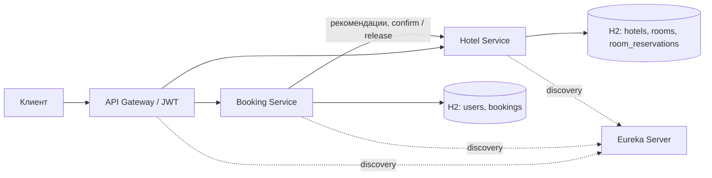

# Hotel Project

REST API для бронирования отелей. Проект состоит из 4-х Spring Boot приложений:
Gateway принимает запросы, Eureka помогает сервисам находить друг друга,
Hotel управляет отелями и номерами, Booking — пользователями и бронированиями.

Пользователь может найти свободный номер, выбрать его самостоятельно или
воспользоваться автоподбором. Администратор управляет отелями, номерами
и пользователями, а также просматривает статистику занятости.

- [Запуск](#docker-compose)
- [Доступы и Swagger](#доступы-и-swagger)
- [Проверка проекта](#проверка-проекта)
- [Архитектура](#архитектура)
- [API](#api)
- [Бронирование и согласованность данных](#бронирование-и-согласованность-данных)
- [Настройки и диагностика](#настройки-и-диагностика)
- [Пример запросов](#сквозной-пример-запросов)

## Docker Compose

Для запуска нужен Docker с Linux-контейнерами и Compose v2. Приложения собираются
в контейнерах, поэтому устанавливать Java и Gradle на хосте не требуется.
При первом запуске загружаются образы и зависимости.

Из корня репозитория:

```sh
docker compose up --build -d
docker compose logs access
```

Сообщение `Local stack is ready` означает, что приложения готовы к работе.
Контейнеры `setup` и `access` после подготовки завершаются с кодом 0.
4 приложения продолжают работать.

| Приложение              | Адрес                                 |
|-------------------------|---------------------------------------|
| API Gateway             | http://localhost:8080/api/v1          |
| Eureka                  | http://localhost:8761/                |
| Swagger Booking Service | http://localhost:8082/swagger-ui.html |
| Swagger Hotel Service   | http://localhost:8081/swagger-ui.html |

У каждого приложения есть `/actuator/health`. Состояние контейнеров и логи:

```sh
docker compose ps -a
docker compose logs -f booking-service hotel-service
```

Если стандартные порты заняты, их можно изменить через локальный `.env`
по образцу `.env.example`. Внутренние адреса контейнеров при этом не меняются.

### Доступы и Swagger

Compose создает ключи, аккаунт ADMIN и тестового USER со случайными паролями.
Учетные данные и готовые JWT копируются командой:

```sh
docker compose cp booking-service:/run/local/access/. ./secrets
```

| Роль и логин         | Файл с паролем                 | Файл с токеном           |
|----------------------|--------------------------------|--------------------------|
| ADMIN `hotel_admin`  | compose-admin-credentials.json | compose-admin-token.json |
| USER `compose_guest` | compose-user-credentials.json  | compose-user-token.json  |

В Swagger в поле `Authorize.userBearer` указывается значение `accessToken`
без префикса `Bearer`. ADMIN используется для управления данными и статистики,
USER — для бронирований и личной истории. Роль ADMIN сама по себе не дает
доступ к пользовательским бронированиям.

Токены действуют 1 час. Для обновления:

```sh
docker compose run --build --rm --no-deps tools access
docker compose cp booking-service:/run/local/access/. ./secrets
```

Каталог `secrets/` исключен из Git. Ключи и пароли хранятся в Docker volumes
и не включаются в образы. Приватный ключ доступен только Booking Service.

Swagger обращается напрямую к выбранному бизнес-сервису. Спецификации доступны
без авторизации по `/v3/api-docs` и `/v3/api-docs.yaml` на портах 8081 и 8082.
Схема `serviceBearer` в Hotel относится к внутренним вызовам Booking.
Пользовательский токен для них не подходит.

### Демонстрационные данные

При запуске создается `Demo Hotel` с четырьмя номерами:

| Номер | Состояние                                        |
|-------|--------------------------------------------------|
| 101   | Одна подтвержденная бронь на две ночи, счетчик 1 |
| 102   | Две отмененные брони, счетчик 2                  |
| 103   | Свободен, счетчик 0                              |
| 201   | Выведен из эксплуатации, счетчик 0               |

Период первой брони начинается через неделю от текущей даты UTC.
ID и даты выводятся в лог `access`. Набор позволяет проверить рекомендации,
занятость и сохранение истории после отмены. Повторный `tools access`
не создает его заново, пока исходный отель существует.

### Остановка и сброс данных

```sh
docker compose down
```

Обе базы H2 работают в памяти, поэтому после остановки данные теряются.
Ключи и учетные данные остаются в volumes. Следующий запуск создает аккаунты
и демонстрационный набор заново, после него токены копируются повторно.
Перезапуск одного бизнес-сервиса с потерей только его БД не поддерживается.

Полный сброс, включая ключи, пароли и кэш тестовой сборки:

```sh
docker compose down --volumes
```

## Проверка проекта

Проверка API работающего Compose-стенда:

```sh
docker compose run --build --rm --no-deps tools check
```

Сценарий проверяет маршрутизацию, JWT и роли, CRUD, поиск, рекомендации,
бронирование, идемпотентность, конкурентные запросы, историю, отмену и статистику.
Каждый запуск создает собственные данные и не затрагивает существующие брони.

Сборка всех приложений с тестами и Checkstyle:

```sh
docker compose run --build --rm tests
```

Для этой команды работающий стенд не нужен. JUnit и MockMvc проверяют
бизнес-логику, валидацию, доступ, миграции H2, блокировки, тайм-ауты,
потерю ответов, компенсацию и восстановление. Ошибка сборки или теста
завершает команду с ненулевым кодом.

Для ручной проверки в Swagger достаточно создать отель и номер под ADMIN,
затем оформить бронь под USER. После этого доступны личная история, отмена
и статистика под ADMIN. Новая бронь должна начинаться не раньше текущей даты UTC.

### Сбой Hotel Service и восстановление

После успешного `tools check` можно проверить компенсацию при недоступности Hotel:

```sh
docker compose pause hotel-service
docker compose run --build --rm --no-deps tools outage
docker compose unpause hotel-service
docker compose run --build --rm --no-deps tools recovery
```

Во время сбоя ожидается 503/504 и отмененная бронь с `releasePending=true`.
После возобновления Hotel фоновый обработчик освобождает номер и восстанавливает
счетчик. Пауза сохраняет H2, поэтому сценарий проверяет недоступность HTTP
без потери данных. Если проверка прервана, `docker compose unpause hotel-service`
возвращает сервис в работу.

## Архитектура

| Приложение       | Ответственность                            | Хранилище    |
|------------------|--------------------------------------------|--------------|
| discovery-server | Регистрация и обнаружение сервисов         | —            |
| api-gateway      | Проверка JWT и маршрутизация               | —            |
| hotel-service    | Отели, номера, резервирования и статистика | H2           |
| booking-service  | Пользователи, JWT и бронирования           | Отдельная H2 |



Используются Java 21, Spring Boot 4.1.1, Spring Cloud BOM 2025.1.4 и Gradle 9.2.1.
Gateway работает на Spring Cloud Gateway Server Web MVC. Бизнес-сервисы
используют Spring MVC, Spring Data JPA, Flyway, H2, Bean Validation и Lombok.
Защита API построена на Spring Security Resource Server, документация —
на springdoc-openapi 3.2.0. Версии зависимостей указаны в `build.gradle` приложений.
У каждого приложения свой Gradle Wrapper, общей сборки нет.

### Архитектурные решения

**ADR-001. Раздельные сервисы и БД.** Booking хранит пользователей и бронирования,
Hotel — отели, номера и резервирования. Сервисы обмениваются HTTP-запросами
через Eureka и LoadBalancer, к чужой БД не обращаются. H2 in-memory выбрана
по условию задания.

**ADR-002. Сага с компенсацией.** Каждый шаг сохраняется в локальной транзакции,
HTTP выполняется между транзакциями. Незавершенное освобождение остается в БД
и повторяется в фоне. Конечное состояние `RELEASED` защищает от запоздавшего confirm.

**ADR-003. Подбор по счетчику.** Hotel сортирует свободные номера по `timesBooked`,
затем по ID. После конфликтов Booking обновляет рекомендации, исключая уже
проверенные номера. Так свободный номер не теряется при изменении выдачи.

**ADR-004. Проверка доступа в сервисах.** Gateway проверяет пользовательский JWT,
а бизнес-сервисы независимо проверяют токен, роли и владельца данных.
Методная безопасность включена через `@PreAuthorize`. Внутренний JWT Booking
имеет отдельную аудиторию и право `reservations:write`.

**ADR-005. Обработка сбоев и диагностика.** Booking обращается к Hotel через
интерфейс HTTP-клиента. Тайм-ауты и повторы ограничивают время операции,
CircuitBreaker прекращает вызовы при повторяющихся сбоях. OpenTelemetry
передает контекст запросов между сервисами.

### Данные

| Сервис  | Таблица           | Основные данные                                       |
|---------|-------------------|-------------------------------------------------------|
| Booking | users             | Логин, хеш пароля и роль                              |
| Booking | bookings          | Пользователь, номер, даты, статус и requestId         |
| Hotel   | hotels            | Название и адрес                                      |
| Hotel   | rooms             | Отель, номер, операционная доступность и times_booked |
| Hotel   | room_reservations | bookingId, requestId, даты и состояние резервирования |

Схемы создаются миграциями Flyway из `src/main/resources/db/migration`
каждого бизнес-сервиса. Hibernate проверяет соответствие сущностей схеме.
Уникальные ограничения защищают логины, номера внутри отеля, пары
`(user_id, request_id)` и `(booking_id, room_id)`. Внешние ключи связывают
только таблицы одной БД. В `bookings` также хранятся срок операции, флаг
`release_pending`, причина освобождения, время следующей попытки и версия записи.
Для истории и очереди восстановления добавлены индексы.

## API

Публичные запросы проходят через Gateway по `/api/v1`. Те же пути доступны
напрямую в соответствующем бизнес-сервисе. Полные схемы запросов, ответов
и ошибок приведены в Swagger.

| Метод и путь                             | Назначение                                  | Доступ      |
|------------------------------------------|---------------------------------------------|-------------|
| POST /api/v1/users/register              | Регистрация и выдача токена                 | Без токена  |
| POST /api/v1/users/auth                  | Вход                                        | Без токена  |
| GET, POST /api/v1/users                  | Список и создание пользователей             | ADMIN       |
| GET, PATCH, DELETE /api/v1/users/{id}    | Просмотр, изменение и удаление пользователя | ADMIN       |
| GET /api/v1/hotels и /api/v1/hotels/{id} | Просмотр отелей                             | USER, ADMIN |
| POST /api/v1/hotels                      | Создание отеля                              | ADMIN       |
| PATCH, DELETE /api/v1/hotels/{id}        | Изменение и удаление отеля                  | ADMIN       |
| POST /api/v1/rooms                       | Создание номера                             | ADMIN       |
| GET /api/v1/rooms/{id}                   | Просмотр номера                             | USER, ADMIN |
| PATCH, DELETE /api/v1/rooms/{id}         | Изменение и удаление номера                 | ADMIN       |
| GET /api/v1/rooms                        | Поиск свободных номеров                     | USER, ADMIN |
| GET /api/v1/rooms/recommend              | Рекомендации Hotel Service                  | USER, ADMIN |
| GET /api/v1/rooms/statistics             | Статистика занятости                        | ADMIN       |
| GET /api/v1/bookings/recommendations     | Рекомендации Booking Service                | USER        |
| POST /api/v1/bookings                    | Создание бронирования                       | USER        |
| GET /api/v1/bookings                     | Личная история                              | USER        |
| GET, DELETE /api/v1/bookings/{id}        | Просмотр и отмена своей брони               | USER        |

Регистрация и вход принимают `username` и `password`. Логин уникален с учетом
регистра и содержит от 3 до 64 латинских букв, цифр или символов `_.-`.
Пароль занимает от 12 до 72 байт UTF-8. При регистрации назначается роль USER.
Вход возвращает `accessToken`, `tokenType` и `expiresIn`, регистрация — объекты
`user` и `token`. В остальных запросах используется `Authorization: Bearer <token>`.

Для создания отеля нужны `name` и `address`, для номера — `hotelId`, `number`
и `available`. Имя отеля ограничено 200 символами, адрес — 500, номер — 32.
Неизвестные поля и неверные типы отклоняются. В PATCH пропущенные поля сохраняются,
явный `null` не принимается. Удалить отель с номерами, пользователя с бронированиями
или номер с историей резервирований нельзя. Номер с текущей или будущей бронью
также нельзя вывести из эксплуатации.

Списки принимают `page` от 0 и `size` от 1 до 100, по умолчанию 20.
Ответ содержит `content`, `page`, `size`, `totalElements`. ID сущностей —
положительные числа, `requestId` — UUID. Ошибки возвращаются как
`application/problem+json` с полем `code`. Ошибка запроса дает 400, отсутствие
валидного токена — 401, недостаток прав — 403, отсутствующий ресурс — 404,
конфликт — 409. Чужая бронь также возвращает 404.

### Поиск, рекомендации и статистика

Поиск и рекомендации принимают обязательные `startDate`, `endDate`
в формате `YYYY-MM-DD` и необязательный `hotelId`. Интервал включает начало
и исключает конец, `startDate` должна быть раньше `endDate`. Поиск за прошедшие
даты допустим. В выдачу входят номера с `available=true` без пересекающихся
резервирований. Рекомендации отсортированы по `timesBooked`, затем по ID.
Обычный поиск использует порядок по ID.

`available` означает возможность эксплуатации номера, например отсутствие
ремонта. Занятость на даты определяется резервированиями. Поиск сам по себе
не бронирует номер.

Статистика принимает те же даты и фильтр отеля. Для каждого номера возвращаются
`timesBooked`, `bookedNights`, `totalNights` и `occupancyRate`. Занятые ночи
считаются внутри запрошенного периода. Например, 4 ночи из 10 дают
загрузку `0.4`. Исторический счетчик `timesBooked` периодом отчета не ограничен.

### Совместимые маршруты Gateway

Для адресов из примера задания сохранены алиасы. Основное API использует
множественное число ресурсов.

| Алиас                              | Канонический путь      |
|------------------------------------|------------------------|
| POST /api/v1/user/register         | /api/v1/users/register |
| POST /api/v1/user/auth             | /api/v1/users/auth     |
| POST /api/v1/user                  | /api/v1/users          |
| PATCH, DELETE /api/v1/user?id={id} | /api/v1/users/{id}     |
| POST /api/v1/booking               | /api/v1/bookings       |
| GET, DELETE /api/v1/booking/{id}   | /api/v1/bookings/{id}  |

## Бронирование и согласованность данных

При явном выборе POST `/api/v1/bookings` принимает `requestId`, `autoSelect=false`,
`roomId`, `startDate` и `endDate`. Для автоподбора передаются `autoSelect=true`
и `hotelId`, поле `roomId` игнорируется. Начало новой брони не может быть раньше
текущей даты UTC, конец должен быть позже начала. Пользователь определяется по JWT.

Booking сохраняет `PENDING`, затем запрашивает подтверждение у Hotel.
Hotel блокирует строку номера, проверяет пересечение дат и сохраняет резервирование
в одной транзакции. После успешного ответа Booking переводит бронь в `CONFIRMED`
и возвращает 201. Конкурирующая заявка на занятый период получает 409.

При автоподборе Booking читает рекомендации порциями по 20 номеров.
Если кандидатов успели занять, выдача обновляется с исключением проверенных ID.
Весь подбор ограничен общим временем операции.

Повтор одного `requestId` тем же пользователем возвращает прежнюю бронь:
200 для завершенной операции или 202, пока она в `PENDING`. Если значимые параметры
изменились, возвращается 409 `IDEMPOTENCY_CONFLICT`. Повтор отмененного запроса
не запускает создание заново.

При ошибке подтверждения бронь становится `CANCELLED`, а Booking освобождает
слот через компенсацию. Это требуется и при потере ответа, когда Hotel мог
успеть сохранить резервирование. Если освобождение не удалось, остается
`releasePending=true`. Фоновый обработчик повторяет его после восстановления связи.
Сбой Hotel возвращается как 503, тайм-аут или исчерпание срока операции — как 504.

DELETE `/api/v1/bookings/{id}` отменяет свою бронь и сохраняет ее в истории.
После освобождения номера ответ — 200 с `releasePending=false`. Если освобождение
еще требуется, ответ — 202, состояние можно узнать через GET по `Location`.
Повторная отмена не создает дополнительных изменений.

`timesBooked` увеличивается при подтверждении резервирования. Компенсация
неуспешного создания уменьшает счетчик, пользовательская отмена подтвержденной
брони сохраняет его. Поэтому счетчик и занятость по датам могут различаться.

Внутренние POST `/api/v1/rooms/{id}/confirm-availability` и
`/api/v1/rooms/{id}/release` доступны только Booking со служебным JWT.
Они используют `bookingId` и `requestId` для идемпотентности и не публикуются
через Gateway. Освобождение окончательное, поздний confirm не возвращает
отмененную бронь в работу.

## Настройки и диагностика

Для обычного запуска достаточно настроек Compose. Вызовы Hotel имеют тайм-ауты,
ограниченное число повторов и растущую задержку. CircuitBreaker учитывает
последние 20 вызовов и начинает оценку после первых 10. Если доля сбоев достигает
50%, новые вызовы блокируются на 10 секунд. Затем разрешаются 3 пробных вызова.
Ответы 404 и 409 не считаются отказами зависимости.

В ответе `X-Trace-Id` указан идентификатор запроса, по которому можно найти
JSON-записи Gateway, Booking и Hotel. Между сервисами передается W3C `traceparent`.
Восстановление дополнительно логируется с `bookingId` и `requestId`.
Внешний сборщик трасс для локального запуска не нужен.

JWT действует до истечения срока и не отзывается при смене роли, пароля
или удалении аккаунта. После нового входа токен содержит актуальную роль.

<details>
<summary>Переменные окружения для изменения настроек</summary>

Время задается в миллисекундах.

| Переменная                        | По умолчанию |
|-----------------------------------|--------------|
| HOTEL_CONNECT_TIMEOUT_MS          | 1000         |
| HOTEL_READ_TIMEOUT_MS             | 2000         |
| HOTEL_MAX_ATTEMPTS                | 3            |
| HOTEL_BACKOFF_MS                  | 100          |
| BOOKING_OPERATION_TIMEOUT_MS      | 10000        |
| HOTEL_CIRCUIT_WINDOW_SIZE         | 20           |
| HOTEL_CIRCUIT_MINIMUM_CALLS       | 10           |
| HOTEL_CIRCUIT_FAILURE_RATE        | 50           |
| HOTEL_CIRCUIT_OPEN_DURATION_MS    | 10000        |
| HOTEL_CIRCUIT_HALF_OPEN_CALLS     | 3            |
| BOOKING_RECOVERY_ENABLED          | true         |
| BOOKING_RECOVERY_BATCH_SIZE       | 20           |
| BOOKING_RECOVERY_POLL_INTERVAL_MS | 5000         |
| BOOKING_RECOVERY_RETRY_DELAY_MS   | 5000         |
| BOOKING_RECOVERY_CYCLE_TIMEOUT_MS | 10000        |

Повторы используют экспоненциальную задержку со случайным разбросом
и ограничены общим сроком операции. Число проб CircuitBreaker и размер окна
положительные, `minimum calls` не превышает окно. Порог сбоев задается в процентах.

Compose автоматически передает ключи через `JWT_PUBLIC_KEY` и `JWT_PRIVATE_KEY`,
а параметры первого администратора — через `configtree`.
При отдельном запуске Booking использует `BOOTSTRAP_ADMIN_USERNAME`
и `BOOTSTRAP_ADMIN_PASSWORD`. Инициализацию можно отключить через
`BOOTSTRAP_ADMIN_ENABLED=false`. Существующий ADMIN при повторной инициализации
не меняется, смена пароля выполняется через API пользователей.

`JWT_ISSUER` по умолчанию равен `hotel-booking`, `JWT_AUDIENCE` — `hotel-api`,
`SERVICE_JWT_AUDIENCE` — `hotel-internal`. Значения должны совпадать у сервисов,
которые выпускают и проверяют соответствующие токены.

</details>

## Сквозной пример запросов

Этот сценарий для Bash, curl и Python 3 показывает создание отеля и номеров,
явное бронирование, автоподбор, историю и отмену. Он выполняется после запуска
Compose и копирования доступов. Даты вычисляются относительно текущего дня UTC.
Для повторного запуска нужен новый логин USER или сброс БД.

<details>
<summary>Пример с curl</summary>

Сначала подготавливаются учетные данные USER и токены обеих ролей.
Пароль должен занимать от 12 до 72 байт UTF-8. Если порт Gateway изменен,
это учитывается в `BASE_URL`.

```sh
BASE_URL=http://localhost:8080

json_value() {
  python3 -c 'import json, sys; print(json.load(sys.stdin)[sys.argv[1]])' "$1"
}

umask 077
python3 - <<'PYTHON'
import getpass
import json
from pathlib import Path

credentials = {"username": "hotel_guest", "password": getpass.getpass("Guest password: ")}
Path("secrets/guest-credentials.json").write_text(json.dumps(credentials), encoding="utf-8")
PYTHON

ADMIN_TOKEN=$(curl --fail-with-body --silent --show-error "$BASE_URL/api/v1/users/auth" \
  -H 'Content-Type: application/json' --data-binary @secrets/compose-admin-credentials.json | json_value accessToken)
curl --fail-with-body --silent --show-error "$BASE_URL/api/v1/users/register" \
  -H 'Content-Type: application/json' --data-binary @secrets/guest-credentials.json > /dev/null
USER_TOKEN=$(curl --fail-with-body --silent --show-error "$BASE_URL/api/v1/users/auth" \
  -H 'Content-Type: application/json' --data-binary @secrets/guest-credentials.json | json_value accessToken)
```

Под ADMIN создаются отель и 2 номера. Затем под USER запрашиваются рекомендации.

```sh
HOTEL_ID=$(curl --fail-with-body --silent --show-error "$BASE_URL/api/v1/hotels" \
  -H "Authorization: Bearer $ADMIN_TOKEN" -H 'Content-Type: application/json' \
  --data '{"name":"City Hotel","address":"Central Street, 15"}' | json_value id)
ROOM_ID=$(curl --fail-with-body --silent --show-error "$BASE_URL/api/v1/rooms" \
  -H "Authorization: Bearer $ADMIN_TOKEN" -H 'Content-Type: application/json' \
  --data "{\"hotelId\":$HOTEL_ID,\"number\":\"101\",\"available\":true}" | json_value id)
curl --fail-with-body --silent --show-error "$BASE_URL/api/v1/rooms" \
  -H "Authorization: Bearer $ADMIN_TOKEN" -H 'Content-Type: application/json' \
  --data "{\"hotelId\":$HOTEL_ID,\"number\":\"102\",\"available\":true}"

START_DATE=$(python3 -c 'from datetime import datetime, timedelta, timezone; print((datetime.now(timezone.utc).date() + timedelta(days=7)).isoformat())')
END_DATE=$(python3 -c 'from datetime import datetime, timedelta, timezone; print((datetime.now(timezone.utc).date() + timedelta(days=9)).isoformat())')
curl --fail-with-body --silent --show-error --get "$BASE_URL/api/v1/rooms/recommend" \
  -H "Authorization: Bearer $USER_TOKEN" \
  --data-urlencode "hotelId=$HOTEL_ID" --data-urlencode "startDate=$START_DATE" \
  --data-urlencode "endDate=$END_DATE" --data-urlencode 'page=0' --data-urlencode 'size=20'
```

Явная бронь возвращает 201. Ее повтор с тем же UUID — 200 с прежней записью.
Автоподбор бронирует оставшийся свободный номер.

```sh
REQUEST_ID=$(python3 -c 'import uuid; print(uuid.uuid4())')
BOOKING_REQUEST=$(cat <<JSON
{
  "requestId": "$REQUEST_ID",
  "autoSelect": false,
  "roomId": $ROOM_ID,
  "startDate": "$START_DATE",
  "endDate": "$END_DATE"
}
JSON
)
BOOKING_ID=$(curl --fail-with-body --silent --show-error "$BASE_URL/api/v1/bookings" \
  -H "Authorization: Bearer $USER_TOKEN" -H 'Content-Type: application/json' \
  --data "$BOOKING_REQUEST" | json_value id)
curl --fail-with-body --silent --show-error "$BASE_URL/api/v1/bookings" \
  -H "Authorization: Bearer $USER_TOKEN" -H 'Content-Type: application/json' \
  --data "$BOOKING_REQUEST"

AUTO_REQUEST_ID=$(python3 -c 'import uuid; print(uuid.uuid4())')
curl --fail-with-body --silent --show-error "$BASE_URL/api/v1/bookings" \
  -H "Authorization: Bearer $USER_TOKEN" -H 'Content-Type: application/json' --data-binary @- <<JSON
{
  "requestId": "$AUTO_REQUEST_ID",
  "autoSelect": true,
  "hotelId": $HOTEL_ID,
  "startDate": "$START_DATE",
  "endDate": "$END_DATE"
}
JSON
```

В завершение запрашиваются история, детали и статистика, затем первая бронь
отменяется дважды. Оба ответа содержат `CANCELLED`, исторический счетчик
сохраняется. Вторая бронь остается подтвержденной.

```sh
curl --fail-with-body --silent --show-error "$BASE_URL/api/v1/bookings?page=0&size=20" \
  -H "Authorization: Bearer $USER_TOKEN"
curl --fail-with-body --silent --show-error "$BASE_URL/api/v1/bookings/$BOOKING_ID" \
  -H "Authorization: Bearer $USER_TOKEN"
curl --fail-with-body --silent --show-error --get "$BASE_URL/api/v1/rooms/statistics" \
  -H "Authorization: Bearer $ADMIN_TOKEN" \
  --data-urlencode "hotelId=$HOTEL_ID" --data-urlencode "startDate=$START_DATE" \
  --data-urlencode "endDate=$END_DATE"
curl --fail-with-body --silent --show-error -X DELETE "$BASE_URL/api/v1/bookings/$BOOKING_ID" \
  -H "Authorization: Bearer $USER_TOKEN"
curl --fail-with-body --silent --show-error -X DELETE "$BASE_URL/api/v1/bookings/$BOOKING_ID" \
  -H "Authorization: Bearer $USER_TOKEN"
```

</details>
